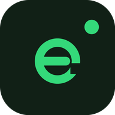

# Engagetal Solutions

### Connecting talent, teams, and ideas.

We're **Engagetal Solutions (OPC) Private Limited**, based in **New Delhi, India**, working with companies and professionals worldwide.

We help companies connect with vetted engineering and go-to-market talent, help professionals develop their skills through the Engagetal Fellowship, and build useful apps and thoughtful games.

## What we do

- **Talent and hiring:** matching companies with professionals assessed for practical skills, communication, and role fit.
- **The Engagetal Fellowship:** practitioner-led learning, mentorship, projects, and preparation for professional work. Explore the current tracks and admissions details on our website.
- **Products:** small tools for everyday tasks and games for curious minds.

## Explore our apps

| Project | What it does | Explore |
| --- | --- | --- |
| **KCleaner** | A free, MIT-licensed Mac utility that pauses keyboard input while you clean. Built with Swift, SwiftUI, and AppKit for macOS 13+. | [Source](https://github.com/engagetal/KCleaner) · [Download](https://github.com/engagetal/KCleaner/releases/latest) |
| **Engineer's Eye** | Spatial puzzles and engineering challenges for Android. | [Our apps](https://engagetal.com/apps) |
| **Nimzle** | Quick-play puzzles for Android. | [Our apps](https://engagetal.com/apps) |

## Open source

KCleaner is our public macOS utility project. Explore the code, report reproducible issues, suggest improvements, or contribute a focused pull request. Each repository states its own license and contribution guidelines.

We value practical evidence, clear communication, and respect for people's time. Our public repositories are a place to share what we build and improve it together.

## Work with us

[Hire talent](https://engagetal.com) · [Join the talent pool](https://engagetal.com/join-talent) · [Explore the Fellowship](https://engagetal.com/fellowship) · [Read our research](https://engagetal.com/research) · [About Engagetal](https://engagetal.com/about.html)

**Website:** [engagetal.com](https://engagetal.com)  
**Email:** [hello@engagetal.com](mailto:hello@engagetal.com)  
**Location:** New Delhi, India  
**LinkedIn:** [Engagetal Solutions](https://www.linkedin.com/company/engagetal-solutions)

Built by Engagetal Solutions (OPC) Private Limited.
